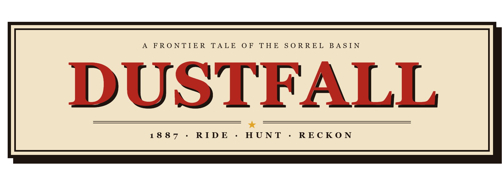
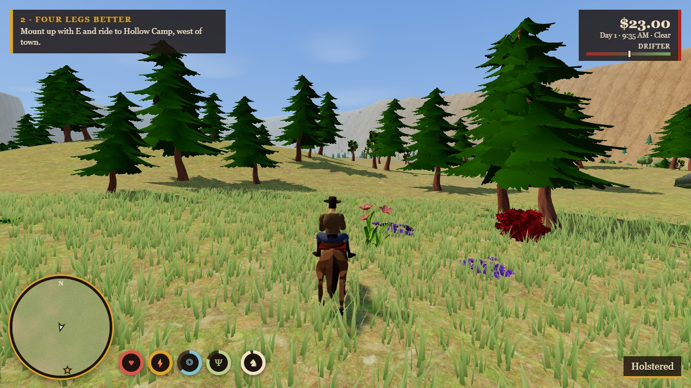
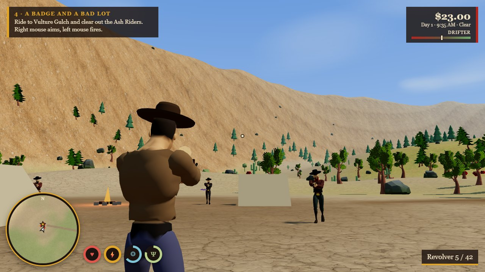
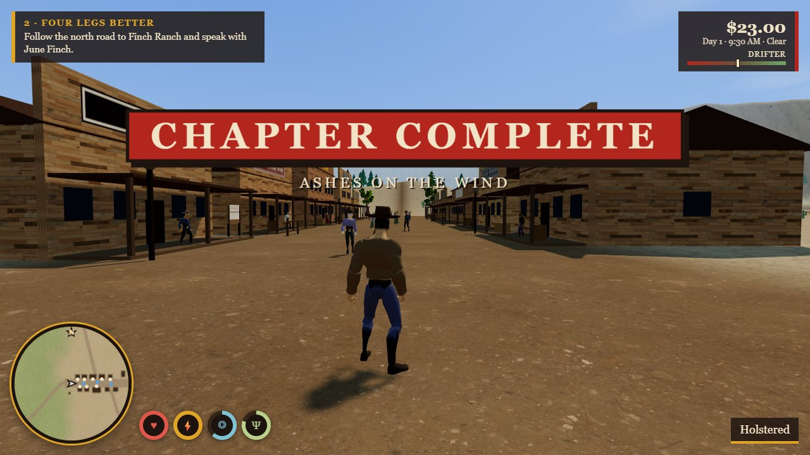
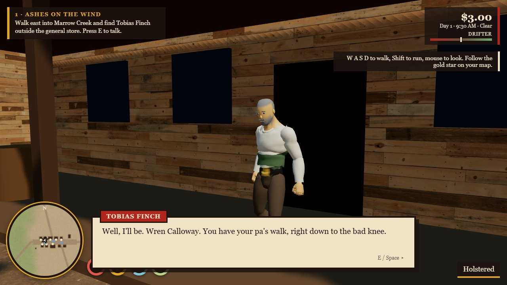
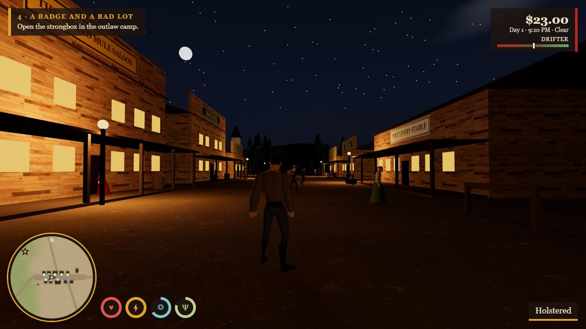

<p align="center">
  
</p>

<p align="center">
  <b>An original open-world western that runs in your browser.</b><br>
  Ride, hunt, fish, play cards, and settle an old score in the Sorrel Basin.
</p>

<p align="center">
  
  
  
  
</p>

<p align="center">
  
</p>

> **About this project.** Dustfall was created to test the Claude Fable 5.2 model. The whole game, from the
> story to the shaders, was written by the model in Claude Code from chat prompts.

## Screenshots

| | |
| --- | --- |
|  |  |
|  |  |

## Features

- **A living basin.** A town, two ranches, a rail depot, outlaw camps, a river and a bridge, with day and night, rain, storms and dust.
- **Your horse.** Calm a wild mare, name her, then ride, gallop, whistle, feed and pat her to build trust.
- **Gunplay.** Revolver, rifle and silent bow, headshots, a slow-time Focus ability and a quick-draw duel.
- **Law and honour.** Crimes need witnesses. Bounties bring posses, and your honour changes prices and the ending.
- **Life on the trail.** Hunt and skin game, cook at camp, fish the river, eat, sleep, and play blackjack at the saloon.
- **Story.** Six chapters with dialogue and choices, then free roam with repeatable bounty hunts and chance encounters.
- **Saving.** Progress is saved in the browser, automatically and with F5.

## Play

You need [Node.js](https://nodejs.org) 20 or newer.

```bash
git clone https://github.com/webKing021/dustfall.git
cd dustfall
npm install
npm run dev
```

Open the address Vite prints, then click the game to capture the mouse. On Windows you can also double-click `play.bat`.

## Controls

| Key | Action | Key | Action |
| --- | --- | --- | --- |
| W A S D | Move / steer horse | 1 2 3 4 | Holster, revolver, rifle, bow |
| Mouse | Look | Right / left mouse | Aim / shoot (punch when holstered) |
| Shift / Ctrl | Sprint or gallop / walk | R | Reload |
| Space / C | Jump / crouch | Q | Focus (slow time) |
| E | Talk, mount, loot, skin, use | X | Quick eat or drink |
| H / B | Whistle for horse / pat horse | G | Rob someone you are aiming at |
| Tab / M / J | Satchel / map / journal | F5 / Esc | Save / pause |

## How it is built

- **Engine:** [Three.js](https://threejs.org) with plain JavaScript modules, bundled by [Vite](https://vite.dev). No game framework.
- **People:** one rigged body with skeletal animation. Clothes are generated in code as smoothed layers over the body, and faces, hats and guns are attached to bones.
- **World:** procedural terrain with four blended photo textures, wind-animated grass that follows the camera, and trees that swap to cheap stand-ins at a distance.
- **Sound:** every effect and the music are synthesised with the Web Audio API. There are no audio files.

| File | Holds |
| --- | --- |
| `src/world.js` | Terrain, sky, weather, water, grass, buildings, collision |
| `src/models.js` | Animated people and animals, clothing, faces |
| `src/actors.js` | AI, the law, wildlife, chance encounters |
| `src/player.js` | Player, horse, gunplay, camera |
| `src/story.js` | Characters, missions, bounties, shops, saving |
| `src/ui.js` | HUD, dialogue, menus, map, blackjack |
| `tools/` | Headless browser tests, profiler and screenshot scripts |

## Credits

The story, characters, map and code are original to this project. All third-party art is public domain (CC0):

- Models and animations by [Quaternius](https://quaternius.com)
- Ground and wood textures from [Poly Haven](https://polyhaven.com)

The full list is in [`public/assets/CREDITS.txt`](public/assets/CREDITS.txt).
